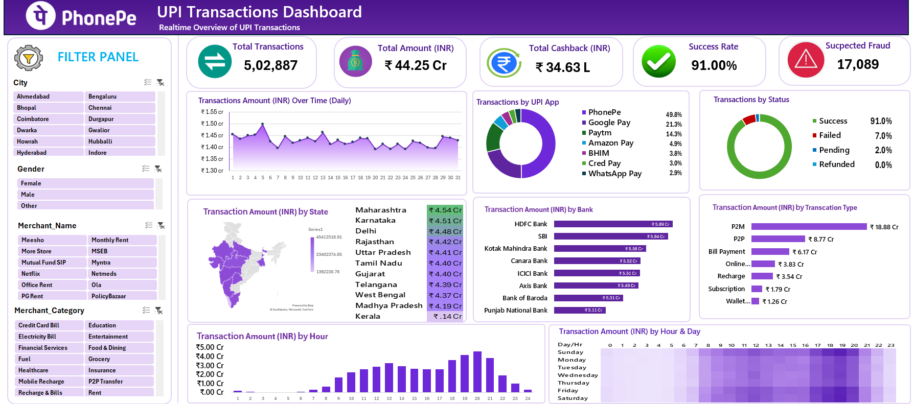

# PhonePe UPI Transactions Analysis

## 📊 Project Overview

An interactive Excel dashboard developed to analyze **500K+ UPI transactions** and identify transaction trends, payment app performance, transaction status, geographic performance, banking performance, transaction types, and potential fraud patterns.

## 🛠️ Tools & Technologies

- Microsoft Excel
- Pivot Tables
- Pivot Charts
- Excel Formulas
- Data Visualization
- Interactive Slicers
- Dashboard Development

## 📌 Key KPIs

| KPI | Value |
|---|---:|
| Total Transactions | 5,02,887 |
| Total Transaction Amount | ₹44.25 Cr |
| Total Cashback | ₹34.63 L |
| Success Rate | 91.00% |
| Suspected Fraud Transactions | 17,089 |

## 📈 Analysis Performed

- Daily transaction amount trends
- UPI application performance
- Transaction status analysis
- Transaction amount by state
- Transaction amount by bank
- Transaction type analysis
- Hourly transaction analysis
- Hour × Day transaction patterns
- Merchant and customer segmentation
- Suspected fraud analysis

## 🎛️ Dashboard Features

The dashboard includes interactive filters for:

- City
- Gender
- Merchant Name
- Merchant Category

## 🖼️ Dashboard Preview

## 💡 Key Skills Demonstrated

- Data Analysis
- Microsoft Excel
- KPI Analysis
- Data Visualization
- Pivot Table Analysis
- Interactive Dashboard Development
- Business Insights
- Data Storytelling

## 📁 Project Files

- **Excel Dashboard:** `PhonePe_UPI_Transactions_Analysis.xlsx`
- **Dashboard Screenshot:** `Screenshots/PhonePe_Dashboard.png`

## 👤 Author

**Kaviyarasan E.**
